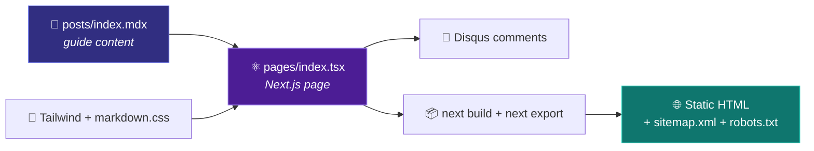

<div align="center">


<br />

<a href="#-projects"></a>
<a href="#-privacy-guide-site"></a>
<a href="#-contributing"></a>

<br />


<br />


**Privacy shouldn't be a barrier. It should be built in.**

</div>

---

## 👋 About

**DataShield Lightweight Labs** is an open-source initiative focused on practical tools, frameworks and research that improve **data privacy**, **security** and **AI safety** in modern software.

As AI systems and cloud-native applications continue to scale, safeguarding user data and enforcing robust security controls become a responsibility for every engineer. The goal here is to make that easier: small, transparent, developer-friendly tools that teams of any size can adopt in an afternoon.

## 🎯 Focus areas

<table>
  <tr>
    <td width="33%" valign="top">
      <h3>🤖 AI Privacy &amp; Safety</h3>
      <ul>
        <li>Preventing PII leakage in LLMs</li>
        <li>Redaction pipelines for model inputs and outputs</li>
        <li>Privacy-preserving middleware for generative AI workflows</li>
      </ul>
    </td>
    <td width="33%" valign="top">
      <h3>🛡️ Application Security</h3>
      <ul>
        <li>Open-source security scanners</li>
        <li>Misconfiguration detection for cloud and databases</li>
        <li>Threat-modeling templates and tooling</li>
      </ul>
    </td>
    <td width="33%" valign="top">
      <h3>📋 Compliance &amp; Risk</h3>
      <ul>
        <li>Developer-first tools aligned with GDPR, CCPA, SOC 2</li>
        <li>Data-minimization utilities</li>
        <li>Consent and data-lifecycle tracking modules</li>
      </ul>
    </td>
  </tr>
</table>

## 🧪 Projects

| | Project | What it does | Status |
|:-:|---|---|:-:|
| 🛡️ | **[AI Privacy Guardrail](https://github.com/liuxiaomingskm/AI-Privacy-Guardrail)** | Redacts emails, phone numbers, IPs, card numbers and API keys before you prompt an AI model, using consistent placeholders like `[EMAIL_1]`, then restores the real values in the reply. 100% in-browser. · [**Live demo →**](https://liuxiaomingskm.github.io/AI-Privacy-Guardrail/) |  |
| ☁️ | **cloud-sec-auditor** | Lightweight scanner for security risks in cloud database configurations: public endpoints, weak auth, missing encryption |  |
| 📖 | **[Privacy guide site](#-privacy-guide-site)** | A Next.js + MDX site hosting a practical guide to protecting your privacy online (in this repo) |  |

## 📖 Privacy guide site

This repository contains a small, statically exportable website that publishes **《如何在网络中保护隐私》**, a practical, Chinese-language guide to protecting your privacy online.

> [!NOTE]
> The guide was written by **[KallyDev](https://github.com/kallydev) and the community** (October 2021), as credited in the article's byline. This repo hosts it as part of the lab's privacy-education resources.

<details open>
<summary><b>📚 What the guide covers</b></summary>

<br />

| Topic | 主题 |
|---|---|
| What online privacy is, and how it differs from anonymity | 网络隐私的定义 |
| The real-world harm of leaked personal data | 隐私泄漏的危害 |
| Checking whether your data has leaked (Firefox Monitor, Have I Been Pwned) | 检查隐私泄漏情况 |
| Choosing open-source browsers and privacy extensions | 使用开源浏览器 · 增强你的浏览器 |
| Open-source input methods | 使用开源输入法 |
| Isolating untrusted apps in virtual machines | 使用虚拟机安装不可信软件 |
| Refusing unnecessary data collection and face recognition | 拒绝上传非必要信息 · 避免使用人脸识别 |
| Hiding your email / phone from search, auditing app permissions | 关闭邮箱和手机号搜索功能 · 检查应用权限 |
| Blurring and watermarking images before sharing | 给图片打码和添加水印 |
| Why protecting privacy matters | 保护隐私的意义 |

</details>

### 🏗️ How the site is built



## 🚀 Getting started

> [!IMPORTANT]
> The site uses **Next.js 11**, which expects **Node.js 14–16**. With newer Node versions, use a version manager, for example `nvm use 16`.

```bash
git clone https://github.com/liuxiaomingskm/datashield-lightweight-labs.git
cd datashield-lightweight-labs
yarn install
yarn dev          # → http://localhost:3000
```

<details>
<summary><b>📦 Build &amp; deploy a static site</b></summary>

<br />

```bash
export SITE_URL=https://your-domain.example            # used by next-sitemap
export NEXT_PUBLIC_SITE_URL=https://your-domain.example # used by Disqus
export NEXT_PUBLIC_SITE_TITLE="Privacy Guide"

yarn deploy       # next-sitemap → next build → next export  (output: ./out)
```

Upload `./out` to any static host: GitHub Pages, Netlify, Vercel or Cloudflare Pages.

| Script | What it does |
|---|---|
| `yarn dev` | Start the dev server with hot reload |
| `yarn build` | Production build |
| `yarn start` | Serve the production build |
| `yarn lint` | Run ESLint (`next lint`) |
| `yarn deploy` | Generate the sitemap, then build and export static HTML |

</details>

<details>
<summary><b>📁 Project layout</b></summary>

<br />

```
pages/
  _app.tsx          App shell, global styles
  _document.tsx     HTML document
  index.tsx         Home page: renders the guide + Disqus thread
posts/
  index.mdx         The privacy guide (MDX)
styles/
  globals.css       Tailwind base
  markdown.css      Article typography
public/             Static assets
next.config.js      MDX support
next-sitemap.js     Sitemap / robots.txt generation
assets/             README artwork
```

</details>

## 🗺️ Roadmap

- [x] Privacy guide site (Next.js + MDX)
- [x] **AI Privacy Guardrail**: client-side PII and secret redaction for LLM prompts
- [ ] **cloud-sec-auditor**: cloud database misconfiguration scanner
- [ ] Redaction middleware for server-side LLM pipelines
- [ ] Data-minimization and consent-tracking utilities
- [ ] English edition of the privacy guide

## 🤝 Contributing

Security and privacy are community efforts. If you care about AI safety, cloud security or data protection:

- 🐛 **[Open an issue](https://github.com/liuxiaomingskm/datashield-lightweight-labs/issues)** for bugs, ideas or new modules
- 🔧 **Submit a PR**: small, focused changes are easiest to review
- 💡 **Share a tool** you'd like to see built

Help build a safer digital ecosystem, one line of code at a time.

## 📄 License

[MIT License](LICENSE)

<div align="center">

<br />

**If you find this useful, a ⭐ helps more developers discover it.**

</div>
