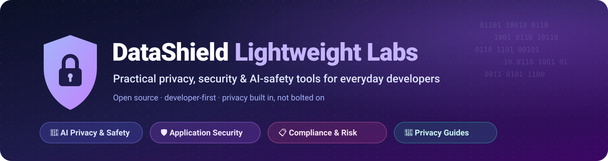

<p align="center">
  
</p>

<p align="center">
  
  
  
  
  
  
  
</p>

<p align="center">
  <code>about</code> · <a href="#02--projects"><code>projects</code></a> · <a href="#03--privacy-guide"><code>privacy-guide</code></a> · <a href="#04--run-it"><code>run-it</code></a> · <a href="#05--roadmap"><code>roadmap</code></a> · <a href="#06--contribute"><code>contribute</code></a>
</p>

---

## 01 · about

> **Privacy shouldn't be a barrier — it should be built in.**

DataShield Lightweight Labs is an open-source initiative for **small, sharp tools** that make data privacy, application security and AI safety easier to get right. No platforms, no sign-ups, no lock-in. Just utilities a developer can read in one sitting and adopt in an afternoon.

```yaml
focus:
  ai-privacy-and-safety:
    - stop PII from leaking into LLM prompts
    - redaction pipelines for model inputs and outputs
    - privacy-preserving middleware for generative-AI workflows
  application-security:
    - open-source security scanners
    - misconfiguration detection for cloud and databases
    - threat-modeling templates and tooling
  compliance-and-risk:
    - developer-first tooling aligned with GDPR, CCPA and SOC 2
    - data-minimization utilities
    - consent and data-lifecycle tracking
principles: [lightweight, transparent, local-first, open-source]
```

## 02 · projects

```diff
+ [live]  ai-privacy-guardrail   Redact emails, phones, IPs, cards and API keys before prompting an AI,
+                                then restore the real values in its reply. Runs 100% in the browser.
+ [live]  privacy-guide          Next.js + MDX site with a practical guide to staying private online.
! [next]  cloud-sec-auditor      Scanner for risky cloud database configs: public endpoints, weak auth,
!                                missing encryption.
```

**→ [AI Privacy Guardrail](https://github.com/liuxiaomingskm/AI-Privacy-Guardrail)** · [live demo](https://liuxiaomingskm.github.io/AI-Privacy-Guardrail/)
&nbsp;&nbsp;Turns `jane@acme.com` into `[EMAIL_1]` before it reaches the model, and back again after.

**→ [Privacy guide](#03--privacy-guide)** · this repo
&nbsp;&nbsp;The website in this repository. Details below.

## 03 · privacy-guide

This repo builds a static site that publishes **《如何在网络中保护隐私》** (*How to Protect Your Privacy Online*), a hands-on, Chinese-language guide.

> [!NOTE]
> Guide written by **[KallyDev](https://github.com/kallydev) and the community** (Oct 2021), as credited in the article's byline. It's hosted here as part of the lab's privacy-education resources.

```text
如何在网络中保护隐私
├── 网络隐私的定义 ............ what privacy is (vs. anonymity)
├── 隐私泄漏的危害 ............ what leaked data is used for
├── 检查隐私泄漏情况 .......... Firefox Monitor, Have I Been Pwned
├── 防范隐私泄漏的方法
│   ├── 使用开源浏览器 ........ open-source browsers
│   ├── 增强你的浏览器 ........ tracker-blocking extensions
│   ├── 使用开源输入法 ........ open-source input methods
│   ├── 使用虚拟机 ............ sandbox untrusted apps in a VM
│   ├── 拒绝上传非必要信息 .... refuse unnecessary data collection
│   ├── 避免使用人脸识别 ...... avoid face recognition
│   ├── 关闭邮箱和手机号搜索 .. hide your email and phone from search
│   ├── 检查应用权限 .......... audit app permissions
│   └── 给图片打码和添加水印 .. blur and watermark shared images
└── 保护隐私的意义 ............ why it matters
```

**How the site is put together**

```text
posts/index.mdx ──► pages/index.tsx ──► next build ──► next export ──► ./out (static HTML)
   (content)          (layout + Disqus)                     │
                                                            └──► next-sitemap: sitemap.xml + robots.txt
styles: Tailwind CSS 2 + styles/markdown.css
```

## 04 · run-it

> [!IMPORTANT]
> Next.js 11 needs **Node.js 14–16**. With newer Node versions, switch first, for example `nvm use 16`.

```console
$ git clone https://github.com/liuxiaomingskm/datashield-lightweight-labs.git
$ cd datashield-lightweight-labs
$ yarn install
$ yarn dev
  ready - started server on http://localhost:3000
```

**Static deploy**

```console
$ export SITE_URL=https://your-domain.example              # sitemap + robots.txt
$ export NEXT_PUBLIC_SITE_URL=https://your-domain.example  # Disqus thread URL
$ export NEXT_PUBLIC_SITE_TITLE="Privacy Guide"
$ yarn deploy                                              # → ./out
```

Upload `./out` to GitHub Pages, Netlify, Vercel or Cloudflare Pages.

| command | does |
|---|---|
| `yarn dev` | dev server with hot reload |
| `yarn build` | production build |
| `yarn start` | serve the production build |
| `yarn lint` | ESLint via `next lint` |
| `yarn deploy` | sitemap → build → static export |

```text
.
├── pages/            _app.tsx · _document.tsx · index.tsx (guide + comments)
├── posts/            index.mdx (the guide)
├── styles/           globals.css · markdown.css
├── public/           static assets
├── assets/           README artwork
├── next.config.js    MDX support
└── next-sitemap.js   sitemap / robots.txt
```

## 05 · roadmap

- [x] Privacy guide site (Next.js + MDX)
- [x] `ai-privacy-guardrail`: client-side PII and secret redaction for LLM prompts
- [ ] `cloud-sec-auditor`: cloud database misconfiguration scanner
- [ ] Server-side redaction middleware for LLM pipelines
- [ ] Data-minimization and consent-tracking utilities
- [ ] English edition of the privacy guide

## 06 · contribute

```console
$ git checkout -b feat/your-idea
$ git commit -m "feat: something that makes data a little safer"
$ git push origin feat/your-idea   # then open a pull request
```

Bug, idea or a tool you wish existed? **[Open an issue](https://github.com/liuxiaomingskm/datashield-lightweight-labs/issues).** Small, focused PRs are easiest to review.

---

<p align="center">
  <sub><a href="LICENSE">MIT License</a> · built one line of code at a time · <b>⭐ star the repo if it's useful</b></sub>
</p>
